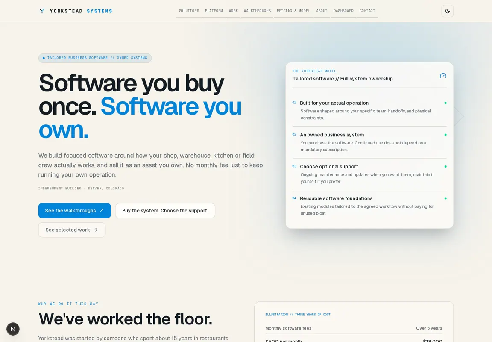
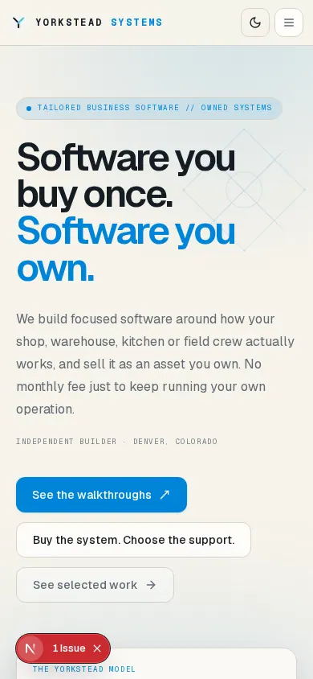
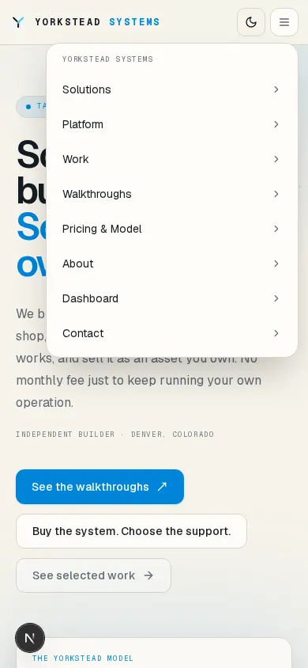

# CC-025 verification record

## Environment and revision

- Checkout: `/home/brandon/development/yorkstead/website-cc025`.
- Base: verified main `363c4dad28b1d0676e4b28887154b74589536e06`; initial feature commit `ace6856165148c0ae5be0821cd8e3b78b311640d` and supplemental commits are published on `feat/cc-025-unified-design-navigation`.
- Runtime: Bun 1.4.2, Node 26.10.0, Next.js 16.4.2. Dependencies were installed from the lockfile and local cache with `bun install --frozen-lockfile --offline`; no dependency files changed.
- GitHub: PR [#82](https://github.com/yorkstead/website/pull/82) is open against `main`, with the exact requested title and verified base SHA. The original delivery check status in run 437 was pending; the final customer-navigation correction at `9f436c9977afa2a142d523bf973cc2577d3ad0a2` passed exact-head run 440 and Vercel (see below). PR #81 is merged at the base SHA; no CC-025 branch or PR existed before delivery. The feature branch was published with Git push.
- No database migration, production setting, secret, customer record, merge or deployment was performed.

## Checks

| Check | Result |
|---|---|
| `bun run yorkstead:check` | PASS — scaffold and active specification structure present. |
| `bun run db:migrate:check` | PASS — all 21 ordered application migrations validated. |
| `bun run lint` | PASS — 0 errors; one pre-existing warning at `components/login-panel.tsx:62`. |
| `bun run typecheck` | PASS. |
| `bun test` | PASS — 420 passed, 112 database-backed skipped, 0 failed (4,197 assertions). Database-backed skips are because no local disposable PostgreSQL is available. |
| `bun run build` | PASS — Next.js production build compiled, typechecked and generated 86 static pages. |
| `bun run design-system` | PASS — generated 54 files; exported color tokens match `app/globals.css`. The build was repaired to remove the stale deleted DemoCard catalog and align its inert analytics preview shim. |
| `bun run test:e2e tests/e2e/cc025-navigation.e2e.ts` | PASS — public mobile/desktop navigation, keyboard menu behavior, active route, and no horizontal page overflow. Screenshots captured at both widths. |
| `bun run test:e2e` | PARTIAL — 25 passed, 8 failed. Six failures require the unavailable local PostgreSQL service for owner-authenticated routes. One existing JWLD gallery test timed out locating its expand button; one existing route-sweep test exceeded 60 seconds under four-worker load and its request context was disposed. No CC-025 navigation assertion failed. |
| `git diff --check` | PASS. |

The full browser suite ran its owner-only routes without a local PostgreSQL server (`ECONNREFUSED 127.0.0.1:5432`). Those checks need the repository's isolated database fixtures; production data was not used. The focused public navigation test ran with Playwright's local Next.js server and passed. Existing owner navigation coverage remains in `tests/e2e-cc017/navigation.e2e.ts`, including destination, active-state, collapse persistence, mobile keyboard, Escape, focus return and responsive overflow checks; the isolated owner database was not available for local execution.

## Screenshots

These screenshots were captured from the local implementation with Playwright. The desktop image is resized for repository review; the phone images show the default page and open navigation menu.

## Acceptance mapping

- Shared semantic link styles, focus rings and active states: `components/navigation/navigation-link-styles.ts`, `components/navigation/navigation-link-styles.test.ts`.
- Existing semantic color tokens unchanged and design-system export remains synchronized: `bun run design-system`.
- Public route hierarchy and current path: `components/site-header.tsx`, adopted by Home, Work, Walkthroughs, Solutions, Platform, Pricing & Model and About; focused browser test exercises `/work` and confirms active route.
- Owner route groups, hash behavior, collapse preference, drawer focus/Escape and route targets: implementation only changes shared link classes in `components/dashboard/dashboard-navigation.tsx`; prior specialized browser tests remain intact.
- Customer section current location: `components/customer-portal/portal-navigation.tsx` uses progressive `IntersectionObserver` enhancement, with Overview as the server-rendered default and a unit-tested visible-section selector.
- Responsive layout, keyboard menu, and page overflow: `tests/e2e/cc025-navigation.e2e.ts` passes at 390px and 1440px.
- Existing lead capture, analytics intake, authorization, project selection, customer data and theme state: no behavior, route, data, auth or database code changed.

## Remaining verification limits

- The full local browser suite is not fully green because it includes database-backed owner/auth flows and unrelated parallel-run flakes listed above. A disposable PostgreSQL-backed CI run is required to verify those specialized owner routes on the final PR head.
- Local owner-browser execution still requires the unavailable disposable PostgreSQL fixture; exact-head CI supplied that fixture and passed the added browser regression. No manual deployment or production operation was performed. No merge was performed.

## PR #82 customer portal observer review correction

- Code commit: `9f436c9977afa2a142d523bf973cc2577d3ad0a2`. Replaced the percentage bottom `rootMargin` with a viewport-height-derived pixel inset clamped to leave at least 64px of observation area. Resize handling coalesces events with `requestAnimationFrame`, disconnects and rebuilds the observer, ignores stale callbacks, and removes the listener/cancels pending work/disconnects during cleanup.
- Added margin unit assertions for 1440×900, 390×844, 390×600 and a short viewport. Added an owner-authenticated browser regression that scrolls the actual portal sections at 1440×900 and 390×844, then resizes to 390×600; each scroll verifies exactly one `aria-current="location"` item.
- Local affected tests: portal unit tests 3/3 pass; full `bun test` 421 pass, 112 database-backed skips, 0 fail; scaffold, 21-migration check, lint, typecheck, production build and diff check pass. Lint reports one pre-existing warning at `components/login-panel.tsx:62`. The local owner browser suite could not initialize because identical disposable `DATABASE_URL` and `TEST_DATABASE_URL` values are unavailable.
- Exact-head GitHub Actions [run 440](https://github.com/yorkstead/website/actions/runs/41045035430) passed on `9f436c9977afa2a142d523bf973cc2577d3ad0a2`, including disposable PostgreSQL, all browser workflows, the CC-017 navigation step containing the new desktop/mobile/resize regression, production build and generated-worktree cleanliness. Vercel passed on the same head.
- Both duplicate P2 review threads were answered with the implementation and test evidence, then resolved after run 440 passed: `PRRT_kwDOUJPn1c6x7q4r` and `PRRT_kwDOUJPn1c6x7xRV`. PR #82 remains open and unmerged. No manual deployment or production operation occurred.
