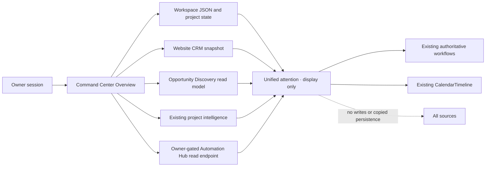

# CC-027 — Unified Attention View

## User value

Give the owner one source-aware overview of existing work that may need attention while keeping each record's current system authoritative. Every displayed item links to its existing workflow; the overview itself is read-only for external records and does not persist copied items.

## Ownership

- GitHub owns engineering issues, pull requests, reviews, and milestones.
- Google Tasks owns personal reminders and one-off actions; Google Calendar owns scheduled commitments.
- Website CRM owns sales follow-ups and canonical inquiry status.
- Opportunity Discovery owns research follow-ups and research state.
- Automation Hub owns automation captures, review items, and execution states.
- Command Center owns project context, project tasks, and business priorities. Existing General Workspace task records and editors remain unchanged.

## Read flow

## Acceptance criteria

- A1: The existing authenticated Command Center Overview contains a compact attention view, not another top-level workspace or task database.
- A2: Workspace project tasks and active project context retain their current persistence and edit/complete behavior elsewhere. The attention view displays them without changing status or due dates and links to the existing task/project editor.
- A3: CRM follow-ups and proposal next actions show canonical CRM status/date/action from the owner-gated existing CRM snapshot and deep-link to `/dashboard/leads?lead=<id>`. No copied or editable CRM lifecycle fields are introduced.
- A4: Research follow-ups due today or overdue use the owner-gated Opportunity Discovery store and deep-link to `/dashboard/opportunities?id=<id>`. Bounded query results are clearly labelled incomplete when the display limit is exceeded.
- A5: GitHub issues and pull requests use current per-project intelligence already fetched by the Command Center and link only to validated `https://github.com` destinations. A source error, stale last-known data, or bounded result is distinct from an empty result.
- A6: Google Tasks, pending review items, and captures use the existing owner-only `/api/dashboard/automation-hub` read contract. The page reports unavailable/not-configured/degraded state separately from empty and shows checked-at/truncated evidence when present. It does not call `/api/briefing` for this view and does not expose credentials.
- A7: Google Calendar remains available through the existing read-only CalendarTimeline and month endpoint; the attention view provides a direct path to that existing section. Calendar events are not presented as action items without source evidence that they require action.
- A8: CRM, Opportunity Discovery, GitHub, Google Tasks, Automation Hub, and Calendar records remain external to this view: no create, update, complete, reschedule, archive, delete, persistence, or automation command is available from the view.
- A9: Each source presents available/populated, available/empty, unavailable, incomplete/truncated, and stale/last-known states where the existing contract provides enough evidence. Missing data is not fabricated; dates and urgency are not inferred.
- A10: All data is available only in the existing owner-authenticated dashboard. No tenant or other-user data is added, no privileged token is sent to the browser, and links are validated or fixed same-origin paths.
- A11: Focused regression coverage verifies source states, source names and canonical status/due/action display, safe links, CRM/research record navigation, no external mutation or aggregation persistence, preservation of existing project task editability, and responsive/accessibility basics.
- A12: Required repository checks and applicable browser tests are recorded; spec, verification record, and active handoff match the implementation. Open one reviewable draft PR; no merge, production change, or deployment.

## Constraints and non-goals

- No new provider, schema, table, copied task store, task synchronization, general task-manager expansion, OAuth consolidation, background reconciliation, write-through action, automation trigger, or duplicate reminder.
- Do not change Workspace document persistence or the project task lifecycle. Do not auto-close project tasks when a project ships or change behavior when a project is deleted.
- Keep the existing Google Task completion flow in its current dedicated interface.
- Do not change the Automation Hub execution contract or the dashboard's existing `/api/briefing` caller in this PR. If that path has side effects, document the follow-up separately.
- Existing CRM, research, and GitHub reads are bounded. Where totals are unavailable, exact-limit results are labelled as potentially incomplete, and the linked source remains the complete queue.
- Google Calendar events stay in the existing CalendarTimeline unless a current safe read model provides a verified action-oriented commitment.

## Rollback

Revert the attention-view component and its call site. No database or external record rollback is needed because this feature does not write or persist aggregated data.
